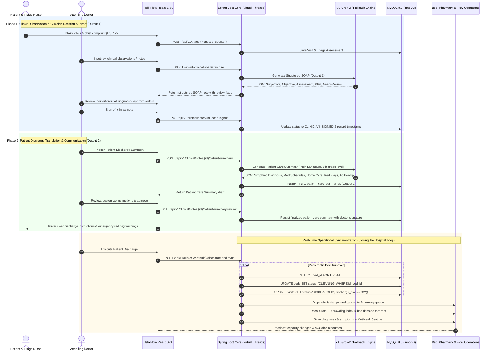
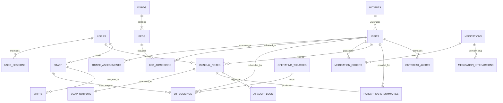

# HelixFlow: Implementation Plan
**AI-Powered Hospital Flow Intelligence and Early Warning System**
*Decision-Support Prototype (Non-Diagnostic) for Healthcare Operations*

---

## Document Control & Executive Summary
- **Project Name:** HelixFlow
- **Document Version:** 1.2.0-CLINICAL-LOOP
- **Target Runtime:** Java 21, Spring Boot 3.4.x (LTS) (Maven), MySQL 8.0, React 18+ (TypeScript), xAI Grok API (`grok-2`)
- **Architecture Style:** Clean Architecture (Modular Monolith with Package-by-Feature)
- **Primary Goal:** Provide hospital administrators, triage nurses, and clinicians with predictive flow intelligence, operation room (OT) conflict resolution, bed capacity forecasting, deterministic medication safety alerting, syndromic outbreak detection, and an **End-to-End Two-Way Clinical Loop** (Patient -> AI -> Doctor -> AI -> Patient): Output 1 (Physician Structured SOAP Note) and Output 2 (Patient-Facing Discharge Summary), integrated directly with **Real-Time Operational Synchronization** (automated bed turnover to `CLEANING`, pharmacy order dispatch, and capacity recalculation).
- **Offline / Demo Resilience:** Configurable dual-mode (`helixflow.ai.mock-mode=true/false`) across both LLM and ML services, ensuring seamless local demos without external API keys or network latency.

---

## 1. Architecture Overview & Component Diagram

### 1.1 Architectural Style & High-Level Principles
HelixFlow is architected as an **Asynchronous Modular Monolith** with a decoupled React SPA frontend. The core system runs as a single Java 21 Spring Boot 3.4.x (LTS) application, utilizing **Project Loom Virtual Threads** (`spring.threads.virtual.enabled=true`) to handle high-concurrency I/O (specifically blocking HTTP calls to the xAI Grok LLM and concurrent DB operations) without thread exhaustion.

Key architectural guardrails:
1. **Decision Support, Not Diagnostic:** The system strictly optimizes operations, flow, and administrative drafting. Machine Learning and LLM outputs are classified as decision-support heuristics with mandatory human clinician sign-off.
2. **In-JVM Machine Learning + Fallback Protection:** Core ML models (bed demand, ED crowding, anomaly detection) train and infer inside the Java virtual machine using Smile 3.x (`smile-core`, `smile-data`). To guarantee that student developers are never blocked by ML compilation or missing model files, a **deterministic fallback rule-based predictor** (`FallbackRuleBasedPredictor`) is embedded directly in the pipeline.
3. **Deterministic Safety vs. Generative Drafting:** High-stakes operations (drug-drug interactions, OT scheduling conflicts) are 100% deterministic rule engines. Generative AI (xAI Grok) is strictly sandboxed to administrative formatting of clinical notes.
4. **Lightweight Custom Security & Virtual Thread Safety:** Spring Security filter chains are excluded in favor of a fast, custom interceptor layer backed by `spring-security-crypto` for BCrypt password hashing. The interceptor is hardened for Java 21 virtual threads (strict `try-finally` context clearing to prevent carrier thread pollution) and explicitly allows CORS pre-flight `OPTIONS` requests.
5. **Concurrency Hardening:** High-contention resources (`beds` allocation and `ot_bookings` reservations) use JPA **Pessimistic Write Locking** (`LockModeType.PESSIMISTIC_WRITE` / `SELECT ... FOR UPDATE`) inside atomic transactions, eliminating race conditions.

### 1.2 System Component Diagram (Mermaid)

```mermaid
graph TB
    subgraph Client Layer [Frontend - React + TypeScript SPA]
        UI_Dash[HelixFlow Executive Dashboard]
        UI_Triage[Registration & Triage Screen]
        UI_Bed[Bed & Capacity Management]
        UI_OT[OT & Staff Scheduling]
        UI_Pharm[Pharmacy & Med Safety]
        UI_SOAP[SOAP Clinical Note Editor]
    end

    subgraph Boundary Layer [HTTP / Security Boundary]
        CORS[CORS WebMvc Configuration]
        AuthInterceptor[Lightweight AuthInterceptor - OPTIONS Allowed]
        GlobalEx[Global Exception & Error Translator]
    end

    subgraph Core Application [Spring Boot 3.4.x / Java 21 Virtual Threads]
        subgraph AuthModule [Auth & Identity Module]
            AuthSvc[Auth Service - BCrypt]
            TokenStore[Token Session Store]
            SecContext[Scoped / ThreadLocal SecurityContext]
        end

        subgraph ResourceModule [Hospital Resource Management]
            BedSvc[Bed Allocation - Pessimistic Write Lock]
            OTSvc[OT Conflict Detector - Pessimistic Lock]
            StaffSvc[Staff Shift Manager]
            MedSafetySvc[Deterministic Drug Interaction Checker]
            SentinelSvc[Outbreak Sentinel Syndromic Detector]
        end

        subgraph ClinicalModule [Clinical Documentation & AI]
            NoteSvc[Clinical Note Service]
            GrokClient[xAI Grok-2 RestClient Gateway]
            SOAPValidator[JSON Schema & Safety Guardrail]
            SOAPFallback[FallbackSoapExtractor Heuristic]
            AuditLogger[AI Audit Log Service]
        end

        subgraph AnalyticsModule [Predictive Analytics & Simulation]
            SyntheticGen[Synthetic Patient Flow Generator]
            MLEngine[Embedded Java ML Engine - Smile 3.x]
            MLFallback[FallbackRuleBasedPredictor Heuristic]
            WhatIfSimulator[Discrete-Time What-If Engine]
        end
    end

    subgraph Data & Storage Layer
        MySQL[(MySQL 8.0 Database)]
        DiskModelStore[(Filesystem Model Store - .bin/.smile)]
    end

    subgraph External Cloud Services
        xAI[xAI Grok REST API - grok-2]
    end

    %% Client to Boundary
    UI_Dash -->|REST / JSON| CORS
    UI_Triage -->|REST / JSON| CORS
    UI_Bed -->|REST / JSON| CORS
    UI_OT -->|REST / JSON| CORS
    UI_Pharm -->|REST / JSON| CORS
    UI_SOAP -->|REST / JSON| CORS

    CORS --> AuthInterceptor
    AuthInterceptor --> GlobalEx

    %% Boundary to Modules
    GlobalEx --> AuthSvc
    GlobalEx --> BedSvc
    GlobalEx --> OTSvc
    GlobalEx --> StaffSvc
    GlobalEx --> MedSafetySvc
    GlobalEx --> SentinelSvc
    GlobalEx --> NoteSvc
    GlobalEx --> MLEngine
    GlobalEx --> WhatIfSimulator

    %% Inter-module connections
    NoteSvc --> GrokClient
    GrokClient -.->|helixflow.ai.mock-mode=false| xAI
    GrokClient -.->|helixflow.ai.mock-mode=true / Error| SOAPFallback
    NoteSvc --> SOAPValidator
    NoteSvc --> AuditLogger
    MLEngine -.->|Models Missing / Mock Mode| MLFallback

    %% Storage connections
    AuthSvc --> MySQL
    BedSvc -->|SELECT ... FOR UPDATE| MySQL
    OTSvc -->|SELECT ... FOR UPDATE| MySQL
    StaffSvc --> MySQL
    MedSafetySvc --> MySQL
    SentinelSvc --> MySQL
    NoteSvc --> MySQL
    AuditLogger --> MySQL
    SyntheticGen --> MySQL
    MLEngine --> DiskModelStore
    MLEngine --> MySQL
```



### 1.3 End-to-End Two-Way Clinical Loop & Real-Time Operational Synchronization

HelixFlow unifies the entire clinical lifecycle through a bidirectional decision-support loop and synchronous hospital operations bridge:



#### Dual-Output Architecture Matrix
| Property | Output 1: Clinician-Facing SOAP Note | Output 2: Patient-Facing Discharge Summary |
| :--- | :--- | :--- |
| **Target Audience** | Physicians, Specialists, Ward Nurses | Patients, Caregivers, Families |
| **Storage Table** | `soap_outputs` (linked 1:1 with `clinical_notes`) | `patient_care_summaries` (linked 1:1 with `clinical_notes`, 1:N with `visits`) |
| **Language Register** | Precise medical terminology (e.g. "Acute pyelonephritis", "Tachycardia") | Plain language, 6th-grade reading level ("Kidney infection", "Fast heart rate") |
| **Core Sections** | Subjective, Objective, Assessment, Plan, Clinician Review Flags | Simplified Diagnosis, Medication Schedules, Home Care, Red Flags, Follow-Up |
| **Medication Handling** | Clinical dosing, pharmacokinetics, route (`IV Cefazolin 1g Q8H`) | Timing, meal pairing, side-effects ("Take 1 tablet every 8 hours with food") |
| **Emergency Safety** | Differential diagnoses, risk stratifications | Explicit "When to Return to the ER Immediately" bullet points |
| **Sign-Off Policy** | Mandatory physician edit/approval (`CLINICIAN_SIGNED`) | Doctor digital sign-off and verification before printing or distribution |

---

## 2. Monorepo & Project Folder Structure

```
helixflow/
├── docker/
│   ├── docker-compose.yml              # Multi-container orchestration (MySQL, Backend, Frontend)
│   ├── Dockerfile.backend              # Multi-stage JDK 21 build
│   ├── Dockerfile.frontend             # Vite build + Nginx static serving
│   └── mysql-init/
│       ├── 01-schema.sql               # Base DDL with pessimistic locking indexes
│       └── 02-seed-interactions.sql    # Curated drug-drug interaction matrix
├── docs/
│   ├── architecture/                   # Architecture decision records (ADRs)
│   ├── api/                            # OpenAPI 3.0 / Swagger JSON specifications
│   ├── prompts/                        # Grok-2 system prompts & evaluation datasets
│   └── models/                         # ML feature definitions & benchmark logs
├── frontend/                           # React + TypeScript + Vite SPA
│   ├── index.html
│   ├── package.json
│   ├── tsconfig.json
│   ├── vite.config.ts
│   └── src/
│       ├── assets/                     # Icons, brand SVGs, static assets
│       ├── components/                 # Reusable UI widgets
│       │   ├── common/                 # Button, Modal, Card, Input, Badge, Toast
│       │   ├── layout/                 # TopNav, Sidebar, AppLayout, PageHeader
│       │   └── feedback/               # SeverityBanner, LoadingSpinner, ErrorAlert
│       ├── features/                   # Feature-sliced UI components
│       │   ├── auth/                   # Login screen, AuthContext
│       │   ├── dashboard/              # Executive overview, KPI cards, flow charts
│       │   ├── registration-triage/    # Patient intake, ESI score calculator
│       │   ├── beds/                   # Ward layout, Bed grid, Transfer modal
│       │   ├── ot/                     # Timeline scheduler, booking modal, conflict alert
│       │   ├── staff/                  # Roster view, shift assignment modal
│       │   ├── pharmacy/               # Medication order form, safety alert modal
│       │   ├── clinical-notes/         # Note editor, AI SOAP generator, diff reviewer
│       │   ├── sentinel/               # Outbreak cluster map, syndromic alerts
│       │   └── simulation/             # What-if slider panel, impact projection charts
│       ├── services/                   # API client layer
│       │   ├── apiClient.ts            # Central Axios client with token injection & error handling
│       │   ├── authApi.ts
│       │   ├── resourceApi.ts
│       │   ├── clinicalApi.ts
│       │   └── analyticsApi.ts
│       ├── types/                      # TypeScript definitions mirroring backend DTOs
│       ├── styles/                     # Vanilla CSS design system
│       │   ├── variables.css           # Color tokens, spacing, typography
│       │   ├── global.css              # Reset, base styles
│       │   └── components.css          # Glassmorphism, animations, responsive grid
│       └── App.tsx
└── backend/                            # Spring Boot 3.4.x Maven Project
    ├── pom.xml                         # Maven dependencies (Java 21, Boot 3.4.x, Smile 3.x)
    └── src/
        ├── main/
        │   ├── java/com/helixflow/
        │   │   ├── HelixFlowApplication.java
        │   │   ├── config/             # Spring configuration beans
        │   │   │   ├── WebMvcConfig.java          # Interceptor registration, CORS mapping
        │   │   │   ├── RestClientConfig.java      # Virtual-thread enabled RestClient bean
        │   │   │   └── JacksonConfig.java         # JavaTimeModule & serialization
        │   │   ├── security/           # Lightweight token-based security
        │   │   │   ├── AuthInterceptor.java       # HandlerInterceptor with OPTIONS bypass & safe finally cleanup
        │   │   │   ├── SecurityContext.java       # ThreadLocal / ScopedValue context for current user
        │   │   │   ├── TokenService.java          # In-memory / DB-backed session token manager
        │   │   │   ├── PasswordService.java       # BCryptPasswordEncoder wrapper
        │   │   │   ├── RequireRole.java           # Custom authorization annotation
        │   │   │   └── Role.java                  # Role enum (ADMIN, DOCTOR, NURSE, PHARMACIST, RECEPTIONIST)
        │   │   ├── common/             # Cross-cutting concerns
        │   │   │   ├── dto/
        │   │   │   │   ├── ApiResponse.java       # Standard generic envelope
        │   │   │   │   └── ApiError.java          # Standard structured error shape
        │   │   │   ├── exception/
        │   │   │   │   ├── GlobalExceptionHandler.java
        │   │   │   │   ├── ResourceNotFoundException.java
        │   │   │   │   ├── BusinessRuleException.java
        │   │   │   │   └── UnauthorizedException.java
        │   │   │   └── audit/
        │   │   │       ├── AuditLog.java          # Audit entity for AI and critical ops
        │   │   │       └── AuditLogRepository.java
        │   │   └── modules/            # Package-by-Feature Domain Modules
        │   │       ├── auth/
        │   │       │   ├── controller/AuthController.java
        │   │       │   ├── dto/LoginRequest.java
        │   │       │   ├── dto/LoginResponse.java
        │   │       │   ├── entity/User.java
        │   │       │   ├── entity/UserSession.java
        │   │       │   ├── repository/UserRepository.java
        │   │       │   └── service/AuthService.java
        │   │       ├── patient/
        │   │       │   ├── controller/PatientController.java
        │   │       │   ├── controller/TriageController.java
        │   │       │   ├── dto/PatientRegistrationDto.java
        │   │       │   ├── dto/TriageAssessmentDto.java
        │   │       │   ├── entity/Patient.java
        │   │       │   ├── entity/Visit.java
        │   │       │   ├── entity/TriageAssessment.java
        │   │       │   ├── repository/PatientRepository.java
        │   │       │   ├── repository/VisitRepository.java
        │   │       │   └── service/PatientFlowService.java
        │   │       ├── resource/
        │   │       │   ├── bed/
        │   │       │   │   ├── controller/BedController.java
        │   │       │   │   ├── dto/BedAllocationDto.java
        │   │       │   │   ├── entity/Ward.java
        │   │       │   │   ├── entity/Bed.java
        │   │       │   │   ├── entity/BedAdmission.java
        │   │       │   │   ├── repository/BedRepository.java  # Includes PESSIMISTIC_WRITE locks
        │   │       │   │   └── service/BedManagementService.java
        │   │       │   ├── ot/
        │   │       │   │   ├── controller/OtController.java
        │   │       │   │   ├── dto/OtBookingRequest.java
        │   │       │   │   ├── entity/OperatingTheatre.java
        │   │       │   │   ├── entity/OtBooking.java
        │   │       │   │   ├── repository/OtBookingRepository.java # Includes PESSIMISTIC_WRITE locks
        │   │       │   │   └── service/OtSchedulingService.java
        │   │       │   ├── staff/
        │   │       │   │   ├── controller/StaffController.java
        │   │       │   │   ├── dto/ShiftAssignmentDto.java
        │   │       │   │   ├── entity/Staff.java
        │   │       │   │   ├── entity/Shift.java
        │   │       │   │   ├── repository/ShiftRepository.java
        │   │       │   │   └── service/StaffSchedulingService.java
        │   │       │   ├── medication/
        │   │       │   │   ├── controller/MedicationController.java
        │   │       │   │   ├── dto/MedicationSafetyCheckRequest.java
        │   │       │   │   ├── dto/SafetyAlertDto.java
        │   │       │   │   ├── entity/Medication.java
        │   │       │   │   ├── entity/MedicationInteractionRule.java
        │   │       │   │   ├── entity/MedicationOrder.java
        │   │       │   │   ├── repository/MedicationInteractionRepository.java
        │   │       │   │   └── service/MedicationSafetyService.java
        │   │       │   └── outbreak/
        │   │       │       ├── controller/OutbreakSentinelController.java
        │   │       │       ├── dto/ClusterAlertDto.java
        │   │       │       ├── entity/OutbreakAlert.java
        │   │       │       ├── repository/OutbreakAlertRepository.java
        │   │       │       └── service/OutbreakSentinelEngine.java
        │   │       ├── clinical/
        │   │       │   ├── controller/ClinicalNoteController.java
        │   │       │   ├── dto/RawClinicalNoteRequest.java
        │   │       │   ├── dto/StructuredSoapResponse.java
        │   │       │   ├── dto/SoapReviewSubmissionDto.java
        │   │       │   ├── dto/PatientCareSummaryDto.java
        │   │       │   ├── dto/PatientMedicationInstructionDto.java
        │   │       │   ├── dto/PatientSummaryRequestDto.java
        │   │       │   ├── entity/ClinicalNote.java
        │   │       │   ├── entity/SoapOutput.java              # Output 1 entity
        │   │       │   ├── entity/PatientCareSummary.java       # Output 2 entity
        │   │       │   ├── repository/ClinicalNoteRepository.java
        │   │       │   ├── repository/SoapOutputRepository.java
        │   │       │   ├── repository/PatientCareSummaryRepository.java
        │   │       │   ├── client/GrokRestClient.java        # grok-2 client with mock toggle & backoff
        │   │       │   ├── client/GrokChatRequest.java
        │   │       │   ├── client/GrokChatResponse.java
        │   │       │   ├── parser/SoapSchemaValidator.java
        │   │       │   └── parser/FallbackSoapExtractor.java  # Heuristic fallback
        │   │       └── analytics/
        │   │           ├── controller/AnalyticsController.java
        │   │           ├── dto/CongestionForecastDto.java
        │   │           ├── dto/BedDemandForecastDto.java
        │   │           ├── dto/WhatIfSimulationRequest.java
        │   │           ├── dto/WhatIfSimulationResult.java
        │   │           ├── dto/FlowAnomalyDto.java
        │   │           ├── generator/SyntheticHospitalDataGenerator.java
        │   │           ├── ml/
        │   │           │   ├── ModelPersistenceManager.java
        │   │           │   ├── EdCongestionPredictor.java
        │   │           │   ├── BedDemandPredictor.java
        │   │           │   ├── FlowAnomalyDetector.java
        │   │           │   ├── FallbackRuleBasedPredictor.java # Rule-based fallback predictor
        │   │           │   └── ModelEvaluationMetrics.java
        │   │           ├── simulation/HospitalCapacitySimulator.java
        │   │           └── service/AnalyticsOrchestratorService.java
        │   └── resources/
        │       ├── application.yml             # Base configuration with mock-mode toggles
        │       ├── application-dev.yml
        │       ├── application-prod.yml
        │       └── data/
        │           ├── drug-interactions.json  # Curated offline interaction dataset
        │           └── synthetic-seed.json     # Initial bootstrap operational data
        └── test/
            ├── java/com/helixflow/
            │   ├── security/AuthInterceptorTest.java
            │   ├── resource/OtSchedulingServiceTest.java
            │   ├── resource/BedManagementPessimisticLockTest.java
            │   ├── resource/MedicationSafetyServiceTest.java
            │   ├── clinical/SoapAssistantServiceTest.java
            │   ├── analytics/EdCongestionPredictorTest.java
            │   ├── analytics/HospitalCapacitySimulatorTest.java
            │   └── integration/HelixFlowEndToEndIntegrationTest.java
            └── resources/
                └── application-test.yml
```

---

## 3. MySQL Database Schema & ERD

### 3.1 Entity Relationship Diagram (Mermaid)



### 3.2 Detailed MySQL Table DDL & Column Definitions (with Pessimistic Lock Indexes)

All tables use `InnoDB`, character set `utf8mb4`, and collation `utf8mb4_unicode_ci`.

```sql
-- 1. Users table
CREATE TABLE users (
    id BIGINT AUTO_INCREMENT PRIMARY KEY,
    username VARCHAR(50) NOT NULL UNIQUE,
    email VARCHAR(100) NOT NULL UNIQUE,
    password_hash VARCHAR(255) NOT NULL,
    full_name VARCHAR(100) NOT NULL,
    role VARCHAR(30) NOT NULL, -- 'ADMIN', 'DOCTOR', 'NURSE', 'PHARMACIST', 'RECEPTIONIST'
    is_active BOOLEAN NOT NULL DEFAULT TRUE,
    created_at TIMESTAMP NOT NULL DEFAULT CURRENT_TIMESTAMP,
    updated_at TIMESTAMP NOT NULL DEFAULT CURRENT_TIMESTAMP ON UPDATE CURRENT_TIMESTAMP,
    INDEX idx_users_role (role)
) ENGINE=InnoDB;

-- 2. User Sessions table
CREATE TABLE user_sessions (
    id BIGINT AUTO_INCREMENT PRIMARY KEY,
    user_id BIGINT NOT NULL,
    token VARCHAR(128) NOT NULL UNIQUE,
    expires_at TIMESTAMP NOT NULL,
    created_at TIMESTAMP NOT NULL DEFAULT CURRENT_TIMESTAMP,
    CONSTRAINT fk_sessions_user FOREIGN KEY (user_id) REFERENCES users(id) ON DELETE CASCADE,
    INDEX idx_sessions_token (token),
    INDEX idx_sessions_expires (expires_at)
) ENGINE=InnoDB;

-- 3. Synthetic Patients
CREATE TABLE patients (
    id BIGINT AUTO_INCREMENT PRIMARY KEY,
    mrn VARCHAR(32) NOT NULL UNIQUE, -- Medical Record Number (e.g. 'SYN-84920')
    first_name VARCHAR(50) NOT NULL,
    last_name VARCHAR(50) NOT NULL,
    date_of_birth DATE NOT NULL,
    gender VARCHAR(20) NOT NULL,
    phone VARCHAR(20) NULL,
    emergency_contact VARCHAR(100) NULL,
    created_at TIMESTAMP NOT NULL DEFAULT CURRENT_TIMESTAMP
) ENGINE=InnoDB;

-- 4. Visits / Encounters
CREATE TABLE visits (
    id BIGINT AUTO_INCREMENT PRIMARY KEY,
    patient_id BIGINT NOT NULL,
    visit_number VARCHAR(32) NOT NULL UNIQUE,
    visit_type VARCHAR(20) NOT NULL, -- 'EMERGENCY', 'INPATIENT', 'SURGICAL', 'OUTPATIENT'
    status VARCHAR(20) NOT NULL, -- 'TRIAGE_WAIT', 'IN_TREATMENT', 'ADMITTED', 'DISCHARGED'
    arrival_time TIMESTAMP NOT NULL DEFAULT CURRENT_TIMESTAMP,
    discharge_time TIMESTAMP NULL,
    chief_complaint TEXT NOT NULL,
    assigned_doctor_id BIGINT NULL,
    CONSTRAINT fk_visits_patient FOREIGN KEY (patient_id) REFERENCES patients(id) ON DELETE RESTRICT,
    CONSTRAINT fk_visits_doctor FOREIGN KEY (assigned_doctor_id) REFERENCES users(id) ON DELETE SET NULL,
    INDEX idx_visits_status (status),
    INDEX idx_visits_arrival (arrival_time)
) ENGINE=InnoDB;

-- 5. Triage Assessments
CREATE TABLE triage_assessments (
    id BIGINT AUTO_INCREMENT PRIMARY KEY,
    visit_id BIGINT NOT NULL,
    triaged_by BIGINT NOT NULL,
    esi_level INT NOT NULL, -- Emergency Severity Index: 1 (Immediate/Resus) to 5 (Non-urgent)
    heart_rate INT NULL,
    blood_pressure_sys INT NULL,
    blood_pressure_dia INT NULL,
    respiratory_rate INT NULL,
    temperature_celsius DECIMAL(4,1) NULL,
    o2_saturation INT NULL,
    consciousness_level VARCHAR(20) NOT NULL DEFAULT 'ALERT',
    triage_notes TEXT NULL,
    triage_time TIMESTAMP NOT NULL DEFAULT CURRENT_TIMESTAMP,
    CONSTRAINT fk_triage_visit FOREIGN KEY (visit_id) REFERENCES visits(id) ON DELETE CASCADE,
    CONSTRAINT fk_triage_user FOREIGN KEY (triaged_by) REFERENCES users(id) ON DELETE RESTRICT,
    INDEX idx_triage_esi (esi_level)
) ENGINE=InnoDB;

-- 6. Wards and Beds (with Pessimistic Locking Support)
CREATE TABLE wards (
    id BIGINT AUTO_INCREMENT PRIMARY KEY,
    code VARCHAR(20) NOT NULL UNIQUE,
    name VARCHAR(100) NOT NULL,
    department VARCHAR(50) NOT NULL,
    total_capacity INT NOT NULL,
    created_at TIMESTAMP NOT NULL DEFAULT CURRENT_TIMESTAMP
) ENGINE=InnoDB;

CREATE TABLE beds (
    id BIGINT AUTO_INCREMENT PRIMARY KEY,
    ward_id BIGINT NOT NULL,
    bed_number VARCHAR(20) NOT NULL,
    bed_type VARCHAR(30) NOT NULL,
    status VARCHAR(20) NOT NULL DEFAULT 'AVAILABLE', -- 'AVAILABLE', 'OCCUPIED', 'CLEANING', 'MAINTENANCE'
    version BIGINT NOT NULL DEFAULT 0, -- Secondary optimistic check
    CONSTRAINT fk_beds_ward FOREIGN KEY (ward_id) REFERENCES wards(id) ON DELETE CASCADE,
    UNIQUE KEY uq_ward_bed (ward_id, bed_number),
    INDEX idx_beds_ward_status (ward_id, status), -- Crucial for fast SELECT ... FOR UPDATE queries
    INDEX idx_beds_status (status)
) ENGINE=InnoDB;

-- 7. Bed Admissions
CREATE TABLE bed_admissions (
    id BIGINT AUTO_INCREMENT PRIMARY KEY,
    bed_id BIGINT NOT NULL,
    visit_id BIGINT NOT NULL,
    admitted_at TIMESTAMP NOT NULL DEFAULT CURRENT_TIMESTAMP,
    discharged_at TIMESTAMP NULL,
    notes VARCHAR(255) NULL,
    CONSTRAINT fk_admit_bed FOREIGN KEY (bed_id) REFERENCES beds(id) ON DELETE RESTRICT,
    CONSTRAINT fk_admit_visit FOREIGN KEY (visit_id) REFERENCES visits(id) ON DELETE RESTRICT,
    INDEX idx_admit_active (discharged_at)
) ENGINE=InnoDB;

-- 8. Staff and Shifts
CREATE TABLE staff (
    id BIGINT AUTO_INCREMENT PRIMARY KEY,
    user_id BIGINT NOT NULL UNIQUE,
    staff_code VARCHAR(20) NOT NULL UNIQUE,
    department VARCHAR(50) NOT NULL,
    specialty VARCHAR(50) NULL,
    qualification VARCHAR(50) NOT NULL,
    max_weekly_hours INT NOT NULL DEFAULT 40,
    CONSTRAINT fk_staff_user FOREIGN KEY (user_id) REFERENCES users(id) ON DELETE CASCADE
) ENGINE=InnoDB;

CREATE TABLE shifts (
    id BIGINT AUTO_INCREMENT PRIMARY KEY,
    staff_id BIGINT NOT NULL,
    ward_id BIGINT NULL,
    shift_date DATE NOT NULL,
    start_time TIME NOT NULL,
    end_time TIME NOT NULL,
    shift_type VARCHAR(20) NOT NULL,
    role_in_shift VARCHAR(30) NOT NULL,
    is_cancelled BOOLEAN NOT NULL DEFAULT FALSE,
    CONSTRAINT fk_shift_staff FOREIGN KEY (staff_id) REFERENCES staff(id) ON DELETE CASCADE,
    CONSTRAINT fk_shift_ward FOREIGN KEY (ward_id) REFERENCES wards(id) ON DELETE SET NULL,
    INDEX idx_shift_calendar (shift_date, start_time)
) ENGINE=InnoDB;

-- 9. Operating Theatres & Bookings (with Locking & Conflict Indexes)
CREATE TABLE operating_theatres (
    id BIGINT AUTO_INCREMENT PRIMARY KEY,
    room_number VARCHAR(20) NOT NULL UNIQUE,
    name VARCHAR(50) NOT NULL,
    is_active BOOLEAN NOT NULL DEFAULT TRUE,
    cleaning_buffer_minutes INT NOT NULL DEFAULT 30
) ENGINE=InnoDB;

CREATE TABLE ot_bookings (
    id BIGINT AUTO_INCREMENT PRIMARY KEY,
    theatre_id BIGINT NOT NULL,
    visit_id BIGINT NOT NULL,
    lead_surgeon_id BIGINT NOT NULL,
    procedure_name VARCHAR(150) NOT NULL,
    scheduled_start TIMESTAMP NOT NULL,
    scheduled_end TIMESTAMP NOT NULL,
    actual_start TIMESTAMP NULL,
    actual_end TIMESTAMP NULL,
    status VARCHAR(20) NOT NULL DEFAULT 'SCHEDULED', -- 'SCHEDULED', 'IN_PROGRESS', 'COMPLETED', 'CANCELLED'
    notes TEXT NULL,
    CONSTRAINT fk_ot_theatre FOREIGN KEY (theatre_id) REFERENCES operating_theatres(id) ON DELETE RESTRICT,
    CONSTRAINT fk_ot_visit FOREIGN KEY (visit_id) REFERENCES visits(id) ON DELETE RESTRICT,
    CONSTRAINT fk_ot_surgeon FOREIGN KEY (lead_surgeon_id) REFERENCES staff(id) ON DELETE RESTRICT,
    -- Fast composite indexes for row-lock queries on time windows:
    INDEX idx_ot_theatre_window (theatre_id, status, scheduled_start, scheduled_end),
    INDEX idx_ot_surgeon_window (lead_surgeon_id, status, scheduled_start, scheduled_end)
) ENGINE=InnoDB;

-- 10. Medications and Rule Interactions
CREATE TABLE medications (
    id BIGINT AUTO_INCREMENT PRIMARY KEY,
    code VARCHAR(50) NOT NULL UNIQUE,
    generic_name VARCHAR(100) NOT NULL,
    brand_name VARCHAR(100) NULL,
    dosage_form VARCHAR(50) NOT NULL,
    strength VARCHAR(50) NOT NULL,
    INDEX idx_med_generic (generic_name)
) ENGINE=InnoDB;

CREATE TABLE medication_interactions (
    id BIGINT AUTO_INCREMENT PRIMARY KEY,
    primary_med_id BIGINT NOT NULL,
    interacting_med_id BIGINT NOT NULL,
    severity VARCHAR(20) NOT NULL, -- 'MILD', 'MODERATE', 'SEVERE_CONTRAINDICATED'
    clinical_effect TEXT NOT NULL,
    management_advice TEXT NOT NULL,
    CONSTRAINT fk_med_prim FOREIGN KEY (primary_med_id) REFERENCES medications(id) ON DELETE CASCADE,
    CONSTRAINT fk_med_sec FOREIGN KEY (interacting_med_id) REFERENCES medications(id) ON DELETE CASCADE,
    UNIQUE KEY uq_interaction_pair (primary_med_id, interacting_med_id)
) ENGINE=InnoDB;

CREATE TABLE medication_orders (
    id BIGINT AUTO_INCREMENT PRIMARY KEY,
    visit_id BIGINT NOT NULL,
    medication_id BIGINT NOT NULL,
    prescribed_by BIGINT NOT NULL,
    dose VARCHAR(50) NOT NULL,
    route VARCHAR(30) NOT NULL,
    frequency VARCHAR(30) NOT NULL,
    status VARCHAR(20) NOT NULL DEFAULT 'ACTIVE',
    interaction_overridden BOOLEAN NOT NULL DEFAULT FALSE,
    override_reason TEXT NULL,
    created_at TIMESTAMP NOT NULL DEFAULT CURRENT_TIMESTAMP,
    CONSTRAINT fk_med_order_visit FOREIGN KEY (visit_id) REFERENCES visits(id) ON DELETE RESTRICT,
    CONSTRAINT fk_med_order_med FOREIGN KEY (medication_id) REFERENCES medications(id) ON DELETE RESTRICT,
    CONSTRAINT fk_med_order_user FOREIGN KEY (prescribed_by) REFERENCES users(id) ON DELETE RESTRICT
) ENGINE=InnoDB;

-- 11. Clinical Notes, Grok-2 SOAP, and AI Audit Logs
CREATE TABLE clinical_notes (
    id BIGINT AUTO_INCREMENT PRIMARY KEY,
    visit_id BIGINT NOT NULL,
    author_id BIGINT NOT NULL,
    raw_text LONGTEXT NOT NULL,
    note_type VARCHAR(30) NOT NULL DEFAULT 'PROGRESS_NOTE',
    status VARCHAR(20) NOT NULL DEFAULT 'DRAFT', -- 'DRAFT', 'AI_PROCESSED', 'CLINICIAN_SIGNED'
    created_at TIMESTAMP NOT NULL DEFAULT CURRENT_TIMESTAMP,
    signed_at TIMESTAMP NULL,
    CONSTRAINT fk_notes_visit FOREIGN KEY (visit_id) REFERENCES visits(id) ON DELETE RESTRICT,
    CONSTRAINT fk_notes_author FOREIGN KEY (author_id) REFERENCES users(id) ON DELETE RESTRICT
) ENGINE=InnoDB;

CREATE TABLE soap_outputs (
    id BIGINT AUTO_INCREMENT PRIMARY KEY,
    clinical_note_id BIGINT NOT NULL UNIQUE,
    subjective_json JSON NOT NULL,
    objective_json JSON NOT NULL,
    assessment_json JSON NOT NULL,
    plan_json JSON NOT NULL,
    needs_clinician_review JSON NULL,
    model_version VARCHAR(50) NOT NULL,
    is_fallback BOOLEAN NOT NULL DEFAULT FALSE,
    clinician_edited_json JSON NULL,
    patient_summary_json JSON NULL,
    created_at TIMESTAMP NOT NULL DEFAULT CURRENT_TIMESTAMP,
    CONSTRAINT fk_soap_note FOREIGN KEY (clinical_note_id) REFERENCES clinical_notes(id) ON DELETE CASCADE
) ENGINE=InnoDB;

-- 12. Output 2: Patient-Facing Discharge Summaries (Two-Way Clinical Loop)
CREATE TABLE patient_care_summaries (
    id BIGINT AUTO_INCREMENT PRIMARY KEY,
    clinical_note_id BIGINT NOT NULL UNIQUE,
    visit_id BIGINT NOT NULL,
    simplified_diagnosis TEXT NOT NULL,
    medication_instructions JSON NOT NULL,
    home_care_instructions JSON NOT NULL,
    red_flag_warnings JSON NOT NULL,
    follow_up_instructions TEXT NOT NULL,
    signed_by_doctor_name VARCHAR(100) NOT NULL,
    created_at TIMESTAMP NOT NULL DEFAULT CURRENT_TIMESTAMP,
    CONSTRAINT fk_summary_note FOREIGN KEY (clinical_note_id) REFERENCES clinical_notes(id) ON DELETE CASCADE,
    CONSTRAINT fk_summary_visit FOREIGN KEY (visit_id) REFERENCES visits(id) ON DELETE RESTRICT,
    INDEX idx_summary_visit (visit_id),
    INDEX idx_summary_created (created_at)
) ENGINE=InnoDB;

-- 13. AI Audit Logs
CREATE TABLE ai_audit_logs (
    id BIGINT AUTO_INCREMENT PRIMARY KEY,
    clinical_note_id BIGINT NOT NULL,
    user_id BIGINT NOT NULL,
    request_hash VARCHAR(64) NOT NULL,
    prompt_tokens INT NOT NULL,
    completion_tokens INT NOT NULL,
    latency_ms BIGINT NOT NULL,
    status_code INT NOT NULL,
    error_message TEXT NULL,
    created_at TIMESTAMP NOT NULL DEFAULT CURRENT_TIMESTAMP,
    INDEX idx_audit_created (created_at),
    CONSTRAINT fk_audit_note FOREIGN KEY (clinical_note_id) REFERENCES clinical_notes(id) ON DELETE CASCADE
) ENGINE=InnoDB;

-- 12. Outbreak Alerts and Forecasts
CREATE TABLE outbreak_alerts (
    id BIGINT AUTO_INCREMENT PRIMARY KEY,
    syndrome_cluster VARCHAR(100) NOT NULL,
    detected_count INT NOT NULL,
    baseline_threshold DECIMAL(6,2) NOT NULL,
    z_score DECIMAL(5,2) NOT NULL,
    alert_level VARCHAR(20) NOT NULL,
    sample_visit_ids JSON NOT NULL,
    is_acknowledged BOOLEAN NOT NULL DEFAULT FALSE,
    created_at TIMESTAMP NOT NULL DEFAULT CURRENT_TIMESTAMP,
    INDEX idx_outbreak_time (created_at)
) ENGINE=InnoDB;

CREATE TABLE operational_forecasts (
    id BIGINT AUTO_INCREMENT PRIMARY KEY,
    forecast_type VARCHAR(50) NOT NULL,
    target_time TIMESTAMP NOT NULL,
    predicted_value DECIMAL(8,2) NOT NULL,
    confidence_lower DECIMAL(8,2) NOT NULL,
    confidence_upper DECIMAL(8,2) NOT NULL,
    model_version VARCHAR(50) NOT NULL,
    created_at TIMESTAMP NOT NULL DEFAULT CURRENT_TIMESTAMP,
    INDEX idx_forecast_time (target_time)
) ENGINE=InnoDB;
```

---

## 4. REST API Specification

### 4.1 Global Response Envelope & Error Format
All endpoints return standard HTTP status codes wrapped in a uniform JSON envelope:

#### Success Envelope (`ApiResponse<T>`)
```json
{
  "success": true,
  "data": { ... },
  "error": null,
  "timestamp": "2026-10-24T18:30:00Z"
}
```

#### Failure Envelope (`ApiResponse<Void>`)
```json
{
  "success": false,
  "data": null,
  "error": {
    "code": "RESOURCE_CONFLICT",
    "message": "Bed 'ED-BED-04' is currently locked or occupied by another transaction.",
    "fieldErrors": [
      {
        "field": "bedId",
        "rejectedValue": 4,
        "rule": "BED_MUST_BE_AVAILABLE"
      }
    ]
  },
  "timestamp": "2026-10-24T18:30:00Z"
}
```

### 4.2 Endpoint Inventory by Module

#### Module: Authentication (`/api/v1/auth`)
| Method | Endpoint | Access Role | Description |
|---|---|---|---|
| `POST` | `/api/v1/auth/login` | Public | Authenticates credentials, returns Bearer token & role |
| `POST` | `/api/v1/auth/logout` | Authenticated | Invalidates active user session token |
| `GET` | `/api/v1/auth/me` | Authenticated | Returns current profile and permission roles |

#### Module: Patient Registration & Triage (`/api/v1/patients`, `/api/v1/triage`)
| Method | Endpoint | Access Role | Description |
|---|---|---|---|
| `POST` | `/api/v1/patients` | RECEPTIONIST, ADMIN | Register synthetic patient demographics |
| `GET` | `/api/v1/patients` | All Roles | Search patients by MRN or name query |
| `POST` | `/api/v1/patients/{id}/visits` | RECEPTIONIST, NURSE | Create intake visit / encounter |
| `POST` | `/api/v1/triage` | NURSE, DOCTOR | Submit ESI assessment and vital signs |
| `GET` | `/api/v1/triage/queue` | All Roles | View active ED triage queue ranked by ESI severity |

#### Module: Bed Management (`/api/v1/beds`)
| Method | Endpoint | Access Role | Description |
|---|---|---|---|
| `GET` | `/api/v1/beds` | All Roles | List beds filtered by ward, department, or status |
| `GET` | `/api/v1/beds/summary` | All Roles | Capacity metrics (total, occupied, available, cleaning) |
| `POST` | `/api/v1/beds/admit` | NURSE, DOCTOR, ADMIN | Allocate patient visit to an available bed (Pessimistic lock) |
| `POST` | `/api/v1/beds/transfer` | NURSE, DOCTOR, ADMIN | Transfer patient between beds/wards |
| `POST` | `/api/v1/beds/{id}/discharge` | NURSE, DOCTOR, ADMIN | Discharge patient; mark bed as CLEANING |
| `POST` | `/api/v1/beds/{id}/cleaned` | NURSE, ADMIN | Mark cleaned bed as AVAILABLE |

#### Module: OT & Staff Scheduling (`/api/v1/ot`, `/api/v1/staff`)
| Method | Endpoint | Access Role | Description |
|---|---|---|---|
| `GET` | `/api/v1/ot/theatres` | All Roles | List all operating rooms |
| `GET` | `/api/v1/ot/bookings` | All Roles | Query bookings by date range & theatre |
| `POST` | `/api/v1/ot/bookings` | DOCTOR, ADMIN | Reserve OT room (Pessimistic lock checks room & surgeon) |
| `DELETE` | `/api/v1/ot/bookings/{id}` | DOCTOR, ADMIN | Cancel OT reservation |
| `GET` | `/api/v1/staff` | ADMIN, DOCTOR | List staff members and specialties |
| `GET` | `/api/v1/staff/shifts` | All Roles | Query roster by department and date range |
| `POST` | `/api/v1/staff/shifts` | ADMIN | Create shift assignment (enforces 8h break rule) |

#### Module: Medication Safety (`/api/v1/medications`)
| Method | Endpoint | Access Role | Description |
|---|---|---|---|
| `GET` | `/api/v1/medications` | All Roles | Search formulary medication database |
| `POST` | `/api/v1/medications/check-interactions` | DOCTOR, PHARMACIST | Pre-check drug combinations against active orders |
| `POST` | `/api/v1/medications/orders` | DOCTOR | Prescribe medication (blocks SEVERE without override) |

#### Module: Outbreak Sentinel (`/api/v1/sentinel`)
| Method | Endpoint | Access Role | Description |
|---|---|---|---|
| `GET` | `/api/v1/sentinel/alerts` | All Roles | Get active syndromic clustering warnings |
| `POST` | `/api/v1/sentinel/trigger-scan` | ADMIN | Manually run syndromic moving-window scan |

#### Module: AI Clinical Documentation & Two-Way Clinical Loop (`/api/v1/clinical`)
| Method | Endpoint | Access Role | Description |
|---|---|---|---|
| `GET` | `/api/v1/clinical/encounters` | All Roles | Active patient encounters (`TRIAGE_WAIT`, `IN_TREATMENT`, `ADMITTED`) |
| `GET` | `/api/v1/clinical/encounters/{visitId}` | All Roles | Detailed encounter & vital signs view |
| `POST` | `/api/v1/clinical/notes/{visitId}/draft` | DOCTOR | Save raw unstructured physician note draft |
| `POST` | `/api/v1/clinical/soap/structure` | DOCTOR | **Output 1**: Grok-2 / Heuristic SOAP structuring with review flags |
| `PUT` | `/api/v1/clinical/notes/{noteId}/soap-signoff` | DOCTOR | Clinician reviews, edits, and finalizes SOAP (`CLINICIAN_SIGNED`) |
| `POST` | `/api/v1/clinical/notes/{visitId}/soap-signoff-atomic` | DOCTOR | Atomic note draft creation and SOAP sign-off in single transaction |
| `POST` | `/api/v1/clinical/notes/{noteId}/patient-summary` | DOCTOR | **Output 2**: Generates & persists plain-language Patient Care Summary |
| `GET` | `/api/v1/clinical/notes/{noteId}/patient-summary` | All Roles | Retrieves persisted Output 2 summary for note |
| `GET` | `/api/v1/clinical/visits/{visitId}/patient-summary` | All Roles | Retrieves latest Output 2 discharge summary for visit encounter |
| `PUT` | `/api/v1/clinical/notes/{noteId}/patient-summary/review` | DOCTOR | Doctor reviews, edits instructions, and digitally approves Output 2 |
| `POST` | `/api/v1/clinical/visits/{visitId}/discharge-and-sync` | DOCTOR, ADMIN | **Real-Time Operational Sync**: Discharges visit, triggers bed sanitization (`OCCUPIED` -> `CLEANING`), clears admission |

#### Module: Predictive Analytics & Simulation (`/api/v1/analytics`)
| Method | Endpoint | Access Role | Description |
|---|---|---|---|
| `GET` | `/api/v1/analytics/ed-congestion/forecast` | All Roles | 1-4 hour predicted ED waiting queue & delay |
| `GET` | `/api/v1/analytics/bed-demand/forecast` | All Roles | 24-hour bed shortage risk projection by ward |
| `GET` | `/api/v1/analytics/anomalies` | All Roles | Recent patient-flow and throughput anomalies |
| `POST` | `/api/v1/analytics/simulation/what-if` | ADMIN | Run discrete-time simulation for arrival spikes |
| `POST` | `/api/v1/analytics/synthetic-data/generate` | ADMIN | Trigger synthetic patient & operational data batch |
| `POST` | `/api/v1/analytics/models/train` | ADMIN | Trigger in-memory ML model training & disk save |

---

## 5. Concurrency Hardening & Per-Module Logic

### 5.1 Concurrency & Pessimistic Locking
In healthcare flow systems, double-allocating a bed or double-booking a surgical theatre can lead to severe operational gridlock. HelixFlow implements **Pessimistic Locking** (`SELECT ... FOR UPDATE`) across critical resources:

1. **Bed Allocation (`BedManagementService`):**
   ```java
   @Transactional(isolation = Isolation.READ_COMMITTED, timeout = 5)
   public BedAdmissionDto admitPatient(Long bedId, Long visitId, String notes) {
       // Acquires exclusive row lock in MySQL: SELECT * FROM beds WHERE id = ? FOR UPDATE
       Bed bed = bedRepository.findByIdWithPessimisticLock(bedId)
           .orElseThrow(() -> new ResourceNotFoundException("Bed not found: " + bedId));

       if (bed.getStatus() != BedStatus.AVAILABLE) {
           throw new BusinessRuleException("BED_NOT_AVAILABLE", "Bed is currently " + bed.getStatus());
       }

       bed.setStatus(BedStatus.OCCUPIED);
       bedRepository.save(bed);

       BedAdmission admission = BedAdmission.builder()
           .bed(bed)
           .visit(visitRepository.getReferenceById(visitId))
           .notes(notes)
           .build();
       return bedAdmissionRepository.save(admission).toDto();
   }
   ```
2. **OT Booking Conflict Prevention (`OtSchedulingService`):**
   - The booking transaction queries overlapping bookings for both the theatre and the lead surgeon with pessimistic write locks:
   ```java
   @Transactional(isolation = Isolation.READ_COMMITTED, timeout = 5)
   public OtBookingDto createBooking(OtBookingRequest request) {
       LocalDateTime bufferStart = request.scheduledStart().minusMinutes(30);
       LocalDateTime bufferEnd = request.scheduledEnd().plusMinutes(30);

       // Lock and check room collision
       boolean roomConflict = otBookingRepository.hasOverlappingTheatreBookingWithLock(
           request.theatreId(), bufferStart, bufferEnd);
       if (roomConflict) {
           throw new BusinessRuleException("OT_ROOM_CONFLICT", "Theatre is occupied or buffering in this window");
       }

       // Lock and check surgeon collision
       boolean surgeonConflict = otBookingRepository.hasOverlappingSurgeonBookingWithLock(
           request.leadSurgeonId(), request.scheduledStart(), request.scheduledEnd());
       if (surgeonConflict) {
           throw new BusinessRuleException("SURGEON_CONFLICT", "Lead surgeon is booked elsewhere in this window");
       }

       OtBooking booking = request.toEntity();
       return otBookingRepository.save(booking).toDto();
   }
   ```

### 5.3 Real-Time Operational Synchronization & Bed Turnover Pipeline
When a doctor signs off on discharge and executes operational synchronization (`POST /api/v1/clinical/visits/{visitId}/discharge-and-sync`), HelixFlow triggers an atomic cross-module flow:

1. **Pessimistic Bed Turnover:**
   - The active bed admission (`findTopByVisitIdAndDischargedAtIsNull`) is retrieved.
   - The bed record is locked exclusively (`SELECT ... FOR UPDATE`).
   - Bed status transitions from `OCCUPIED` to `CLEANING`.
   - The admission record is closed (`dischargedAt = NOW()`).
   - The ward's available bed pool is updated, and housekeeping staff are alerted for room sanitization.
   - Upon housekeeping completion, a nurse or ward manager triggers `POST /api/v1/beds/{id}/cleaned`, returning the bed to `AVAILABLE` status.

2. **Visit Encounter Lifecycle:**
   - The visit record status updates to `DISCHARGED` with `discharge_time = NOW()`.
   - The encounter is purged from active ED triage queues and active doctor assignment boards.

3. **Pharmacy Order Dispatch:**
   - Active inpatient medication orders for the visit are cataloged.
   - Prescriptions flagged for outpatient discharge are pushed to the pharmacy dispensing queue with verified drug-drug interaction clearance.

4. **Dynamic Capacity & Anomaly Recalculation:**
   - Real-time census and bed occupancy rates update across the executive dashboard.
   - ED congestion predictors (`EdCongestionPredictor`) and 24-hour bed shortage risk models recalculate immediately based on the newly vacated capacity.

---

## 6. Machine Learning in Java & Fallback Architecture

### 6.1 Library Comparison & Selection

| Dimension | Smile 3.x (Statistical Machine Intelligence and Learning Engine) | Tribuo (Oracle Labs) |
|---|---|---|
| **Java 21 & Spring Boot 3.4.x Compatibility** | **Excellent.** Verified on JDK 21. Standard bytecode operates cleanly on virtual threads. | **Good.** Heavy reflection and type-provenance wrappers add startup latency. |
| **Ergonomics & API Simplicity** | **Very High.** Familiar tabular `smile.data.DataFrame` and simple static model calls. | **Moderate/Verbose.** High conceptual overhead for student teams. |
| **Embedded Model Persistence** | **Simple.** Clean native Java serialization and `.smile` binary format via `smile.io.Read.object()` / `Write.object()`. | **Complex.** Strong ONNX support but adds substantial transitive dependencies. |

#### Architectural Recommendation: **Smile 3.x with Fallback Heuristic**
We maintain Smile 3.x (`smile-core:3.1.1`, `smile-data:3.1.1`) inside the in-JVM monolith. To prevent compilation or model loading issues from halting student development, the system embeds `FallbackRuleBasedPredictor`:
- If Smile model files are missing or corrupted, the system switches to deterministic rolling-average heuristics without throwing an exception.
- When `helixflow.ai.mock-mode=true`, the system serves pre-seeded realistic predictions instantly, enabling 100% offline development.

### 6.2 Architectural Alternative: Option B (Python FastAPI Microservice)
If the team chooses to offload ML training to Python (using Scikit-Learn / XGBoost), an external FastAPI service can be stood up on port `8000`:
- **Protocol:** Spring `RestClient` calls `http://localhost:8000/predict/congestion` and `http://localhost:8000/predict/bed-demand`.
- **Packaging:** Isolated under `/ml-service` with `requirements.txt` (`fastapi`, `uvicorn`, `scikit-learn`, `pandas`).
- **Tradeoff:** Adds a multi-language runtime and network hop. The in-JVM Smile monolith remains the primary recommendation for simplicity.

---

## 7. LLM Plan: xAI Grok-2 Integration & SOAP Assistant

### 7.1 Grok-2 Configuration & Resilience
- **Model Identifier:** `grok-2` (OpenAI-compatible chat completion payload).
- **Endpoint:** `https://api.x.ai/v1/chat/completions`.
- **Virtual Thread Concurrency:** Executed via Spring `RestClient` running on Loom virtual threads.
- **Exponential Backoff & 1-Retry Policy:**
  1. Primary call dispatched with connect timeout = 2000 ms, read timeout = 6000 ms.
  2. If an HTTP 429 (rate limit) or 5xx is encountered, the client waits 1000 ms with random jitter and retries once with `temperature: 0.0`.
  3. If the retry fails or times out, the client circuit-breaks to `FallbackSoapExtractor`.
- **Deterministic Heuristic Fallback (`FallbackSoapExtractor`):**
  - Extracts chief complaint using regex keywords (`"c/o"`, `"presents with"`, `"complaining of"`).
  - Copies vitals if formatted in text (`"BP"`, `"HR"`, `"O2"`).
  - Marks missing sections as `"Not documented"`.
  - Flags note with `is_fallback: true` and `"AI service temporarily unreachable: heuristic draft generated"`.
- **Mock Mode (`helixflow.ai.mock-mode=true`):**
  - Bypasses external HTTP completely.
  - Returns a high-fidelity synthetic SOAP JSON structure (Output 1) or Patient Care Summary (Output 2) within 50 ms.
  - Generates realistic `needsClinicianReview` entries.

### 7.2 Output 1: Clinician-Facing SOAP Structuring Engine

#### System Prompt Specification (Output 1)
```text
You are HelixFlow's Clinical Documentation Structuring Assistant.
Your SOLE purpose is to organize and format raw, unstructured clinical notes into standard SOAP (Subjective, Objective, Assessment, Plan) format.

CRITICAL CLINICAL SAFETY RULES:
1. NON-DIAGNOSTIC: You MUST NEVER generate new diagnoses, prognoses, or medical decisions. Only summarize and organize what the clinician has explicitly documented.
2. NO HALLUCINATION / FACT INVENTING: If a specific clinical element is not mentioned in the raw note, you MUST NOT invent it. Instead, include it under the "notDocumented" list of that section.
3. UNCERTAINTY HANDLING: If any clinician statement is ambiguous or incomplete, place it in the "needsClinicianReview" array with an explanation.
4. STRICT JSON OUTPUT: Return ONLY a valid JSON object matching the schema. No markdown fences.
```

#### JSON Schema (Output 1 - `soap_outputs`)
```json
{
  "subjective": {
    "chiefComplaint": "string",
    "historyOfPresentIllness": "string",
    "reviewOfSystems": "string",
    "notDocumented": ["string"]
  },
  "objective": {
    "vitalSigns": {
      "heartRate": "number",
      "bloodPressure": "string",
      "temperature": "number",
      "respiratoryRate": "number",
      "o2Saturation": "number"
    },
    "physicalExam": "string",
    "labsAndDiagnostics": "string",
    "notDocumented": ["string"]
  },
  "assessment": {
    "primaryImpression": "string",
    "differentialDiagnoses": ["string"],
    "clinicalStatus": "STABLE | GUARDED | CRITICAL",
    "notDocumented": ["string"]
  },
  "plan": {
    "medicationsOrdered": ["string"],
    "proceduresAndInterventions": ["string"],
    "consultations": ["string"],
    "disposition": "DISCHARGE | ADMIT_WARD | ADMIT_ICU | OBSERVE",
    "notDocumented": ["string"]
  },
  "needsClinicianReview": [
    {
      "section": "ASSESSMENT | PLAN | OBJECTIVE",
      "flaggedText": "string",
      "reason": "string"
    }
  ]
}
```

### 7.3 Output 2: Patient-Facing Discharge Summary Engine

#### System Prompt Specification (Output 2)
```text
You are HelixFlow's Patient Care Translation Specialist.
Convert the attending physician's verified Assessment and Plan into an empathetic, highly clear, 6th-grade reading level discharge care summary.
Return ONLY a valid JSON object matching this schema:
{
  "diagnosis": "Clear, reassuring explanation of what condition was found in plain English",
  "medications": [
    {
      "medicationName": "string",
      "dose": "string",
      "frequency": "string",
      "instructions": "Simple plain-language directions, timing, and purpose"
    }
  ],
  "homeCare": ["string of practical instructions and activity limits"],
  "redFlags": ["string of emergency warning signs to return to the ER immediately"],
  "followUp": "Clear timeline and instructions for seeing primary doctor or specialist"
}
Do NOT include markdown formatting or backticks. Return raw JSON only.
```

#### Critical Clinical Guardrails for Output 2:
1. **6th-Grade Reading Level:** Strictly ban Latin abbreviations (`PRN`, `BID`, `TID`, `QHS`, `NPO`). Replace with `"as needed"`, `"twice daily (morning and evening)"`, `"take with food"`.
2. **Empathetic & De-Escalating Tone:** Minimize patient anxiety while conveying critical medical warnings.
3. **Explicit Red Flag Triggers:** Every patient discharge summary must highlight 3-5 life-threatening or urgent signs requiring immediate emergency return (e.g. "Chest pressure or sudden shortness of breath", "Fever over 102°F not responding to medicine", "Inability to keep liquids down for 24 hours").
4. **Mandatory Doctor Signature & Verification:** Patient care summaries are persisted to `patient_care_summaries` table with `signed_by_doctor_name` and can be edited and verified by the attending physician before distribution.

---

## 8. Authentication & RBAC Hardening

### 8.1 Virtual Thread Safety & Scoped Security Context
When using Project Loom virtual threads, thousands of virtual threads are multiplexed across a small number of carrier OS threads. If a `ThreadLocal` is not properly cleared, it can either leak memory or leak state to another virtual thread sharing the carrier:
```java
public class SecurityContext {
    private static final ThreadLocal<UserPrincipal> CURRENT_USER = new ThreadLocal<>();

    public static void set(UserPrincipal user) { CURRENT_USER.set(user); }
    public static UserPrincipal get() { return CURRENT_USER.get(); }
    public static void clear() { CURRENT_USER.remove(); }
}
```

In `AuthInterceptor`, clearing is guaranteed via `afterCompletion`:
```java
@Override
public void afterCompletion(HttpServletRequest request, HttpServletResponse response, Object handler, Exception ex) {
    SecurityContext.clear(); // Mandatory removal prevents ThreadLocal leakage on Loom
}
```

### 8.2 CORS Pre-Flight `OPTIONS` Handling
To prevent Axios or Fetch pre-flight requests from receiving 401 Unauthorized errors from the interceptor, `preHandle` immediately accepts `OPTIONS` requests:
```java
@Override
public boolean preHandle(HttpServletRequest request, HttpServletResponse response, Object handler) {
    if ("OPTIONS".equalsIgnoreCase(request.getMethod())) {
        response.setStatus(HttpServletResponse.SC_OK);
        return true;
    }
    // Proceed with Bearer token validation...
}
```

---

## 9. Non-Functional Requirements & Cross-Cutting Concerns
- **Secrets Management:** Injected via environment variables (`GROK_API_KEY`, `DB_PASSWORD`).
- **Bean Validation:** Jakarta validation constraints (`@NotBlank`, `@NotNull`, `@Min`, `@Max`, `@Positive`, `@Future`) on all incoming DTOs.
- **AI Audit Trail:** Recorded in `ai_audit_logs` (request hash, token usage, latency, fallback flag).
- **Structured JSON Logging:** SLF4J / Logback with MDC tracking `correlationId` and `userId`.

---

## 10. Testing Strategy
- **Unit Testing:** JUnit 5 and Mockito for service-layer rules (medication safety, OT conflicts, bed state transitions).
- **Pessimistic Lock Concurrency Test:** Integration test launching 10 concurrent virtual threads attempting to claim the same bed. Verifies that exactly 1 succeeds and 9 receive clean business conflict errors.
- **MockRestServiceServer Test:** Simulates Grok-2 HTTP 429, HTTP 504, and corrupted JSON to verify fallback resilience.
- **Frontend Vitest:** Validates ESI calculator, bed status badges, and mandatory non-diagnostic disclaimer banner.

---

## 11. Team Work Allocation & Phased Roadmap
- **Member 1 (Frontend):** React + TypeScript SPA, all 8 screens, Chart.js integrations, styling tokens, error boundaries.
- **Member 2 (AI Lead):** Grok-2 client, prompt engineering, JSON schema validator, SOAP fallback engine, AI audit log.
- **Member 3 (Resources Lead):** Bed management with pessimistic locking, OT conflict engine, staff scheduling, medication safety rules, Outbreak Sentinel.
- **Member 4 (Data & ML Lead):** Smile ML models, fallback rule predictor, synthetic data generator, what-if simulator.

---

## 12. Risks and Mitigations

| Risk Description | Probability | Impact | Architectural Mitigation Strategy |
|---|:---:|:---:|---|
| **Spring Boot Version / Compatibility** | Low | High | Standardized on **Spring Boot 3.4.x (LTS)** on Java 21. All dependencies and starters are mature and battle-tested. |
| **Grok LLM Malformed JSON or API Latency** | High | Medium | Explicit exponential backoff, max 1 retry with temperature 0.0, circuit-breaker to `FallbackSoapExtractor`, and `helixflow.ai.mock-mode=true` for demos. |
| **Concurrent Bed or OT Allocation Race Condition** | High | High | Enforced JPA `LockModeType.PESSIMISTIC_WRITE` (`SELECT ... FOR UPDATE`) with composite indexes on time windows and status. |
| **Loom Virtual Thread ThreadLocal Leakage** | Medium | Medium | Strict `finally { SecurityContext.clear(); }` execution inside `AuthInterceptor.afterCompletion()`. |
| **CORS Pre-Flight Block** | High | Medium | Explicit `OPTIONS` method bypass in `AuthInterceptor.preHandle()`. |

---

## 13. Docker Compose & Configuration

### 13.1 `docker-compose.yml`
```yaml
version: '3.8'

services:
  mysql:
    image: mysql:8.0
    container_name: helixflow-mysql
    restart: always
    environment:
      MYSQL_DATABASE: helixflow
      MYSQL_USER: helixflow_user
      MYSQL_PASSWORD: helixflow_password
      MYSQL_ROOT_PASSWORD: root_secure_password
    ports:
      - "3306:3306"
    volumes:
      - mysql_data:/var/lib/mysql
      - ./mysql-init:/docker-entrypoint-initdb.d
    healthcheck:
      test: ["CMD", "mysqladmin", "ping", "-h", "localhost", "-u", "helixflow_user", "-phelixflow_password"]
      interval: 5s
      timeout: 5s
      retries: 10

  backend:
    build:
      context: ../backend
      dockerfile: ../docker/Dockerfile.backend
    container_name: helixflow-backend
    restart: on-failure
    depends_on:
      mysql:
        condition: service_healthy
    environment:
      DB_JDBC_URL: jdbc:mysql://mysql:3306/helixflow?useSSL=false&allowPublicKeyRetrieval=true&serverTimezone=UTC
      DB_USERNAME: helixflow_user
      DB_PASSWORD: helixflow_password
      GROK_API_KEY: ${GROK_API_KEY:-mock-token}
      GROK_MODEL: grok-2
      HELIXFLOW_AI_MOCK_MODE: "true"
      SPRING_THREADS_VIRTUAL_ENABLED: "true"
    ports:
      - "8080:8080"

  frontend:
    build:
      context: ../frontend
      dockerfile: ../docker/Dockerfile.frontend
    container_name: helixflow-frontend
    restart: always
    depends_on:
      - backend
    ports:
      - "3000:80"

volumes:
  mysql_data:
```

---

## 14. Implementation Deliverables: Configuration, Build & Vertical Slice Code

### 14.1 Updated `pom.xml` (Spring Boot 3.4.x LTS & Java 21)

```xml
<?xml version="1.0" encoding="UTF-8"?>
<project xmlns="http://maven.apache.org/POM/4.0.0"
         xmlns:xsi="http://www.w3.org/2001/XMLSchema-instance"
         xsi:schemaLocation="http://maven.apache.org/POM/4.0.0 
         https://maven.apache.org/xsd/maven-4.0.0.xsd">
    <modelVersion>4.0.0</modelVersion>

    <parent>
        <groupId>org.springframework.boot</groupId>
        <artifactId>spring-boot-starter-parent</artifactId>
        <version>3.4.0</version>
        <relativePath/>
    </parent>

    <groupId>com.helixflow</groupId>
    <artifactId>helixflow-backend</artifactId>
    <version>1.0.0-SNAPSHOT</version>
    <name>helixflow-backend</name>
    <description>HelixFlow - Hospital Flow Intelligence &amp; Early Warning System</description>

    <properties>
        <java.version>21</java.version>
        <smile.version>3.1.1</smile.version>
    </properties>

    <dependencies>
        <!-- Spring Boot Starters -->
        <dependency>
            <groupId>org.springframework.boot</groupId>
            <artifactId>spring-boot-starter-web</artifactId>
        </dependency>

        <dependency>
            <groupId>org.springframework.boot</groupId>
            <artifactId>spring-boot-starter-data-jpa</artifactId>
        </dependency>

        <dependency>
            <groupId>org.springframework.boot</groupId>
            <artifactId>spring-boot-starter-validation</artifactId>
        </dependency>

        <!-- MySQL Connector -->
        <dependency>
            <groupId>com.mysql</groupId>
            <artifactId>mysql-connector-j</artifactId>
            <scope>runtime</scope>
        </dependency>

        <!-- Password Hashing (BCrypt ONLY - No Spring Security Filters) -->
        <dependency>
            <groupId>org.springframework.security</groupId>
            <artifactId>spring-security-crypto</artifactId>
        </dependency>

        <!-- Lombok for Boilerplate Reduction -->
        <dependency>
            <groupId>org.projectlombok</groupId>
            <artifactId>lombok</artifactId>
            <optional>true</optional>
        </dependency>

        <!-- In-JVM Machine Learning (Smile 3.x) -->
        <dependency>
            <groupId>com.github.haifengl</groupId>
            <artifactId>smile-core</artifactId>
            <version>${smile.version}</version>
        </dependency>
        <dependency>
            <groupId>com.github.haifengl</groupId>
            <artifactId>smile-data</artifactId>
            <version>${smile.version}</version>
        </dependency>

        <!-- Testing Starter -->
        <dependency>
            <groupId>org.springframework.boot</groupId>
            <artifactId>spring-boot-starter-test</artifactId>
            <scope>test</scope>
        </dependency>
    </dependencies>

    <build>
        <plugins>
            <plugin>
                <groupId>org.springframework.boot</groupId>
                <artifactId>spring-boot-maven-plugin</artifactId>
                <configuration>
                    <excludes>
                        <exclude>
                            <groupId>org.projectlombok</groupId>
                            <artifactId>lombok</artifactId>
                        </exclude>
                    </excludes>
                </configuration>
            </plugin>
        </plugins>
    </build>
</project>
```

### 14.2 Revised `application.yml`

```yaml
server:
  port: 8080
  compression:
    enabled: true
    mime-types: application/json,text/html,text/xml,text/plain

spring:
  application:
    name: helixflow-backend
  threads:
    virtual:
      enabled: true  # Enables Project Loom virtual threads for all HTTP & async tasks
  datasource:
    url: ${DB_JDBC_URL:jdbc:mysql://localhost:3306/helixflow?useSSL=false&allowPublicKeyRetrieval=true&serverTimezone=UTC}
    username: ${DB_USERNAME:helixflow_user}
    password: ${DB_PASSWORD:helixflow_password}
    driver-class-name: com.mysql.cj.jdbc.Driver
    hikari:
      maximum-pool-size: 20
      minimum-idle: 5
      connection-timeout: 20000
  jpa:
    database-platform: org.hibernate.dialect.MySQLDialect
    hibernate:
      ddl-auto: update
    show-sql: false
    properties:
      hibernate:
        format_sql: false
        jdbc:
          time_zone: UTC

helixflow:
  ai:
    mock-mode: ${HELIXFLOW_AI_MOCK_MODE:true} # Toggle for 100% offline demos
  llm:
    grok:
      base-url: ${GROK_BASE_URL:https://api.x.ai/v1}
      model: ${GROK_MODEL:grok-2}
      api-key: ${GROK_API_KEY:}
      connect-timeout-ms: 2000
      read-timeout-ms: 6000
      max-retries: 1
  cors:
    allowed-origins: ${CORS_ALLOWED_ORIGINS:http://localhost:5173,http://localhost:3000}
```

### 14.3 First Vertical Slice Class Scaffolding

#### 1. Security Context & Interceptor
```java
package com.helixflow.security;

import lombok.Builder;
import lombok.Getter;

@Getter
@Builder
public class UserPrincipal {
    private final Long userId;
    private final String username;
    private final Role role;
}
```

```java
package com.helixflow.security;

public class SecurityContext {
    private static final ThreadLocal<UserPrincipal> CURRENT_USER = new ThreadLocal<>();

    public static void set(UserPrincipal principal) {
        CURRENT_USER.set(principal);
    }

    public static UserPrincipal get() {
        return CURRENT_USER.get();
    }

    public static void clear() {
        CURRENT_USER.remove();
    }
}
```

```java
package com.helixflow.security;

import jakarta.servlet.http.HttpServletRequest;
import jakarta.servlet.http.HttpServletResponse;
import lombok.RequiredArgsConstructor;
import org.springframework.stereotype.Component;
import org.springframework.web.method.HandlerMethod;
import org.springframework.web.servlet.HandlerInterceptor;

@Component
@RequiredArgsConstructor
public class AuthInterceptor implements HandlerInterceptor {

    private final TokenService tokenService;

    @Override
    public boolean preHandle(HttpServletRequest request, HttpServletResponse response, Object handler) {
        // Explicitly bypass CORS pre-flight requests to prevent frontend network blocks
        if ("OPTIONS".equalsIgnoreCase(request.getMethod())) {
            response.setStatus(HttpServletResponse.SC_OK);
            return true;
        }

        if (!(handler instanceof HandlerMethod handlerMethod)) {
            return true;
        }

        // Public endpoints
        String path = request.getRequestURI();
        if (path.startsWith("/api/v1/auth/login") || path.startsWith("/api/v1/auth/register")) {
            return true;
        }

        String authHeader = request.getHeader("Authorization");
        if (authHeader == null || !authHeader.startsWith("Bearer ")) {
            response.setStatus(HttpServletResponse.SC_UNAUTHORIZED);
            return false;
        }

        String token = authHeader.substring(7);
        UserPrincipal principal = tokenService.validateAndGetPrincipal(token);
        if (principal == null) {
            response.setStatus(HttpServletResponse.SC_UNAUTHORIZED);
            return false;
        }

        // Role verification
        RequireRole requireRole = handlerMethod.getMethodAnnotation(RequireRole.class);
        if (requireRole == null) {
            requireRole = handlerMethod.getBeanType().getAnnotation(RequireRole.class);
        }

        if (requireRole != null) {
            boolean hasPermission = false;
            for (Role role : requireRole.value()) {
                if (role == principal.getRole() || principal.getRole() == Role.ADMIN) {
                    hasPermission = true;
                    break;
                }
            }
            if (!hasPermission) {
                response.setStatus(HttpServletResponse.SC_FORBIDDEN);
                return false;
            }
        }

        SecurityContext.set(principal);
        return true;
    }

    @Override
    public void afterCompletion(HttpServletRequest request, HttpServletResponse response, Object handler, Exception ex) {
        // Strict cleanup prevents virtual thread carrier contamination
        SecurityContext.clear();
    }
}
```

#### 2. Bed Management with Pessimistic Locking
```java
package com.helixflow.modules.resource.bed.entity;

import jakarta.persistence.*;
import lombok.*;

@Entity
@Table(name = "beds")
@Getter
@Setter
@NoArgsConstructor
@AllArgsConstructor
@Builder
public class Bed {

    @Id
    @GeneratedValue(strategy = GenerationType.IDENTITY)
    private Long id;

    @ManyToOne(fetch = FetchType.LAZY)
    @JoinColumn(name = "ward_id", nullable = false)
    private Ward ward;

    @Column(name = "bed_number", nullable = false, length = 20)
    private String bedNumber;

    @Enumerated(EnumType.STRING)
    @Column(name = "bed_type", nullable = false, length = 30)
    private BedType bedType;

    @Enumerated(EnumType.STRING)
    @Column(name = "status", nullable = false, length = 20)
    private BedStatus status;

    @Version
    private Long version;
}
```

```java
package com.helixflow.modules.resource.bed.repository;

import com.helixflow.modules.resource.bed.entity.Bed;
import com.helixflow.modules.resource.bed.entity.BedStatus;
import jakarta.persistence.LockModeType;
import org.springframework.data.jpa.repository.JpaRepository;
import org.springframework.data.jpa.repository.Lock;
import org.springframework.data.jpa.repository.Query;
import org.springframework.data.repository.query.Param;

import java.util.List;
import java.util.Optional;

public interface BedRepository extends JpaRepository<Bed, Long> {

    @Lock(LockModeType.PESSIMISTIC_WRITE)
    @Query("SELECT b FROM Bed b WHERE b.id = :id")
    Optional<Bed> findByIdWithPessimisticLock(@Param("id") Long id);

    List<Bed> findByWardIdAndStatus(Long wardId, BedStatus status);

    long countByStatus(BedStatus status);
}
```

```java
package com.helixflow.modules.resource.bed.service;

import com.helixflow.common.exception.BusinessRuleException;
import com.helixflow.common.exception.ResourceNotFoundException;
import com.helixflow.modules.patient.entity.Visit;
import com.helixflow.modules.patient.repository.VisitRepository;
import com.helixflow.modules.resource.bed.dto.BedAdmissionDto;
import com.helixflow.modules.resource.bed.entity.Bed;
import com.helixflow.modules.resource.bed.entity.BedAdmission;
import com.helixflow.modules.resource.bed.entity.BedStatus;
import com.helixflow.modules.resource.bed.repository.BedAdmissionRepository;
import com.helixflow.modules.resource.bed.repository.BedRepository;
import lombok.RequiredArgsConstructor;
import org.springframework.stereotype.Service;
import org.springframework.transaction.annotation.Isolation;
import org.springframework.transaction.annotation.Transactional;

@Service
@RequiredArgsConstructor
public class BedManagementService {

    private final BedRepository bedRepository;
    private final VisitRepository visitRepository;
    private final BedAdmissionRepository admissionRepository;

    @Transactional(isolation = Isolation.READ_COMMITTED, timeout = 5)
    public BedAdmissionDto admitPatient(Long bedId, Long visitId, String notes) {
        // Enforces exclusive row lock in database
        Bed bed = bedRepository.findByIdWithPessimisticLock(bedId)
            .orElseThrow(() -> new ResourceNotFoundException("Bed not found: " + bedId));

        if (bed.getStatus() != BedStatus.AVAILABLE) {
            throw new BusinessRuleException("BED_NOT_AVAILABLE", "Bed is currently " + bed.getStatus());
        }

        Visit visit = visitRepository.findById(visitId)
            .orElseThrow(() -> new ResourceNotFoundException("Visit not found: " + visitId));

        bed.setStatus(BedStatus.OCCUPIED);
        bedRepository.save(bed);

        BedAdmission admission = BedAdmission.builder()
            .bed(bed)
            .visit(visit)
            .notes(notes)
            .build();

        return admissionRepository.save(admission).toDto();
    }
}
```

#### 3. Fallback Heuristic Rule Predictor
```java
package com.helixflow.modules.analytics.ml;

import com.helixflow.modules.analytics.dto.CongestionForecastDto;
import lombok.extern.slf4j.Slf4j;
import org.springframework.stereotype.Component;

import java.time.LocalDateTime;

@Slf4j
@Component
public class FallbackRuleBasedPredictor {

    public CongestionForecastDto predictCongestion(int queueDepth, int highEsiCount, double bedOccupancy) {
        log.warn("Executing FallbackRuleBasedPredictor heuristic (ML bypass)");

        // Heuristic formula for waiting queue time
        double estimatedWaitMinutes = (queueDepth * 14.5) + (highEsiCount * 22.0) * (bedOccupancy > 0.85 ? 1.4 : 1.0);
        String severityLevel = estimatedWaitMinutes > 90 ? "CRITICAL" : estimatedWaitMinutes > 45 ? "HIGH" : "NORMAL";

        return new CongestionForecastDto(
            LocalDateTime.now().plusHours(2),
            estimatedWaitMinutes,
            queueDepth + (int)(highEsiCount * 0.8),
            severityLevel,
            "RULE_BASED_FALLBACK"
        );
    }
}
```

#### 4. Grok-2 RestClient with Mock Mode & Exponential Backoff
```java
package com.helixflow.modules.clinical.client;

import com.helixflow.modules.clinical.dto.StructuredSoapResponse;
import com.helixflow.modules.clinical.parser.FallbackSoapExtractor;
import lombok.RequiredArgsConstructor;
import lombok.extern.slf4j.Slf4j;
import org.springframework.beans.factory.annotation.Value;
import org.springframework.stereotype.Component;
import org.springframework.web.client.RestClient;

@Slf4j
@Component
@RequiredArgsConstructor
public class GrokRestClient {

    private final RestClient restClient;
    private final FallbackSoapExtractor fallbackExtractor;

    @Value("${helixflow.ai.mock-mode:true}")
    private boolean mockMode;

    @Value("${helixflow.llm.grok.model:grok-2}")
    private String model;

    public StructuredSoapResponse generateStructuredSoap(String rawClinicalNote) {
        if (mockMode) {
            log.info("helixflow.ai.mock-mode is active. Returning synthetic SOAP draft.");
            return fallbackExtractor.generateMockSoap(rawClinicalNote);
        }

        int maxRetries = 1;
        for (int attempt = 0; attempt <= maxRetries; attempt++) {
            try {
                // Call xAI Grok-2 via RestClient on virtual thread
                return restClient.post()
                    .uri("/chat/completions")
                    .body(new GrokChatRequest(model, rawClinicalNote))
                    .retrieve()
                    .body(StructuredSoapResponse.class);
            } catch (Exception ex) {
                log.warn("Grok-2 API call failed (attempt {}/{}): {}", attempt + 1, maxRetries + 1, ex.getMessage());
                if (attempt < maxRetries) {
                    try { Thread.sleep(1000); } catch (InterruptedException ignored) {}
                }
            }
        }

        log.error("Grok-2 exhausted retries. Invoking FallbackSoapExtractor.");
        return fallbackExtractor.extractHeuristic(rawClinicalNote);
    }
}
```

#### 5. Output 2: PatientCareSummary JPA Entity & Repository
```java
package com.helixflow.modules.clinical.entity;

import com.helixflow.modules.patient.entity.Visit;
import jakarta.persistence.*;
import lombok.*;

import java.time.Instant;

@Entity
@Table(name = "patient_care_summaries")
@Getter
@Setter
@NoArgsConstructor
@AllArgsConstructor
@Builder
public class PatientCareSummary {

    @Id
    @GeneratedValue(strategy = GenerationType.IDENTITY)
    private Long id;

    @OneToOne(fetch = FetchType.LAZY)
    @JoinColumn(name = "clinical_note_id", nullable = false, unique = true)
    private ClinicalNote clinicalNote;

    @ManyToOne(fetch = FetchType.LAZY)
    @JoinColumn(name = "visit_id", nullable = false)
    private Visit visit;

    @Column(name = "simplified_diagnosis", nullable = false, columnDefinition = "TEXT")
    private String simplifiedDiagnosis;

    @Column(name = "medication_instructions", nullable = false, columnDefinition = "LONGTEXT")
    private String medicationInstructions; // JSON array of plain-language med directions

    @Column(name = "home_care_instructions", nullable = false, columnDefinition = "LONGTEXT")
    private String homeCareInstructions; // JSON array of activity limits & recovery steps

    @Column(name = "red_flag_warnings", nullable = false, columnDefinition = "LONGTEXT")
    private String redFlagWarnings; // JSON array of emergency return triggers

    @Column(name = "follow_up_instructions", nullable = false, columnDefinition = "TEXT")
    private String followUpInstructions;

    @Column(name = "signed_by_doctor_name", nullable = false, length = 100)
    private String signedByDoctorName;

    @Builder.Default
    @Column(name = "created_at", nullable = false, updatable = false)
    private Instant createdAt = Instant.now();
}
```

```java
package com.helixflow.modules.clinical.repository;

import com.helixflow.modules.clinical.entity.PatientCareSummary;
import org.springframework.data.jpa.repository.JpaRepository;
import org.springframework.stereotype.Repository;

import java.util.Optional;

@Repository
public interface PatientCareSummaryRepository extends JpaRepository<PatientCareSummary, Long> {
    Optional<PatientCareSummary> findByClinicalNoteId(Long clinicalNoteId);
    Optional<PatientCareSummary> findTopByVisitIdOrderByCreatedAtDesc(Long visitId);
}
```

#### 6. Real-Time Operational Discharge Synchronization
```java
@PostMapping("/visits/{visitId}/discharge-and-sync")
@Transactional
public ResponseEntity<ApiResponse<Map<String, Object>>> dischargeAndSyncHospitalOperations(
        @PathVariable("visitId") Long visitId) {
    Visit visit = visitRepository.findById(visitId)
            .orElseThrow(() -> new ResourceNotFoundException("Visit not found: " + visitId));

    // 1. Bed Management: Transition occupied bed to CLEANING
    bedAdmissionRepository.findTopByVisitIdAndDischargedAtIsNull(visitId)
            .ifPresent(adm -> bedManagementService.dischargePatient(adm.getBed().getId()));

    // 2. Visit lifecycle transition
    visit.setStatus(VisitStatus.DISCHARGED);
    visit.setDischargeTime(Instant.now());
    visitRepository.save(visit);

    return ResponseEntity.ok(ApiResponse.ok(Map.of(
            "visitStatus", "DISCHARGED",
            "message", "Hospital operations synchronized: bed released for cleaning, visit closed."
    )));
}
```

---

## 15. Open Questions & Assumptions for Stakeholder Confirmation

1. **Spring Boot Version:** Pinned to **Spring Boot 3.4.x (LTS)** on Java 21 per user directive.
2. **Offline Mock Mode:** Enabled by default (`helixflow.ai.mock-mode=true`) to ensure student presentations are resilient against internet outages or xAI rate-limits.
3. **ML Strategy:** Smile 3.x is configured in-JVM, fully backed by `FallbackRuleBasedPredictor`. Python FastAPI is cataloged as an optional standalone alternative.
4. **Locking Strategy:** Pessimistic write locks (`SELECT ... FOR UPDATE`) are implemented for bed allocation and OT conflict checks to guarantee zero race conditions.
5. **Two-Way Clinical Loop Policy:** Output 1 (SOAP note) and Output 2 (Patient Care Summary) both enforce mandatory human clinician sign-off (`CLINICIAN_SIGNED` and `signed_by_doctor_name`) prior to patient delivery and bed release.

---
*End of Implementation Plan (v1.2.0-CLINICAL-LOOP). Fully refined and updated with Two-Way Clinical Loop Architecture and Real-Time Operational Synchronization.*

